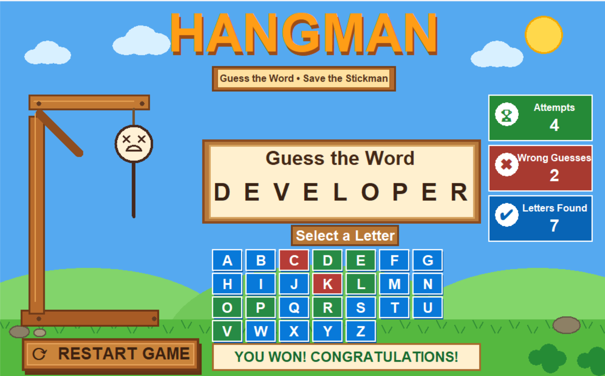

# 🎮 Hangman Game – Python

A fun, cartoon-style Hangman word-guessing game developed using **Python and Tkinter**. Guess the hidden word one letter at a time and save the stickman from being hanged!

## ✨ Features

- 🎨 Attractive cartoon-style graphical interface.
- 🔤 Interactive alphabet buttons for guessing letters.
- ❤️ Limited incorrect attempts to save the stickman.
- 📝 Displays the hidden word with correctly guessed letters.
- 🏆 Win and lose game outcomes.
- 🔄 Restart option to play again.
- 🖱️ Easy-to-use graphical interface.

## 🛠️ Technologies Used

- Python 3
- Tkinter (GUI library)

## 📁 Project Structure

```text
Hangman-game-python/
│
├── hangman.py
├── README.md
└── hangman-game.png
```

## ⚙️ Installation and Setup
### 1. Clone the repository

```bash
git clone https://github.com/gausiyariffathkhan-cloud/Hangman-game-python.git
```

### 2. Open the project folder

```bash
cd Hangman-game-python
```

### 3. Run the game

```bash
python hangman.py
```
The Hangman game window will open on your screen.

## 🖼️ Game Screenshots



## 🎯 Objective
The objective is to guess the hidden word by selecting letters before running out of attempts. Each incorrect guess brings the stickman closer to being hanged.

## 👩‍💻 Developer
Gausiya Riffath Khan
